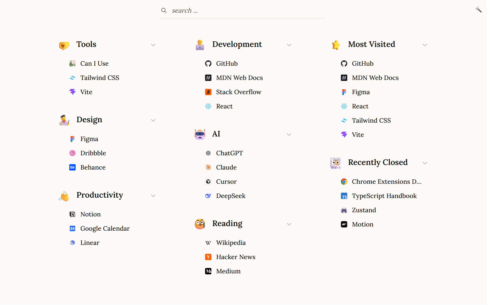
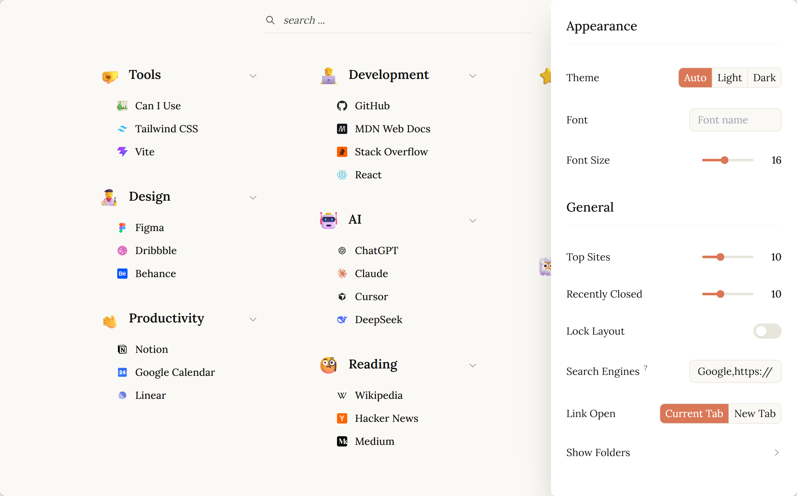

#  Markab - Bookmark New Tab

**Bookmark New Tab — never forget your bookmarks again.**

A Chrome extension that replaces the new tab page with a flat, multi-column bookmark grid. Clean layout, zero clutter.

[**Install on Chrome Web Store →**](https://chromewebstore.google.com/detail/markab/edenohjoklbajppddnaimojnemafnkkg)



## Features

- **Flat layout** — All bookmark folders in a multi-column grid, easy to scan at a glance
- **Drag & drop** — Reorder folders freely; layout and expand state are remembered
- **Light & dark mode** — Follows system theme or override in settings
- **Animated emoji** — Add a lively emoji icon to each folder   
- **Minimal UI** — Focused on bookmarks, nothing extra

## Screenshots

<p align="center">
  
</p>

## Development

Requires [Bun](https://bun.sh).

```bash
bun install
bun run dev
```

Then load the `dist/` folder as an unpacked extension in Chrome.

```bash
bun run build    # production build + zip to release/
```

## License

[Apache License 2.0](LICENSE)
